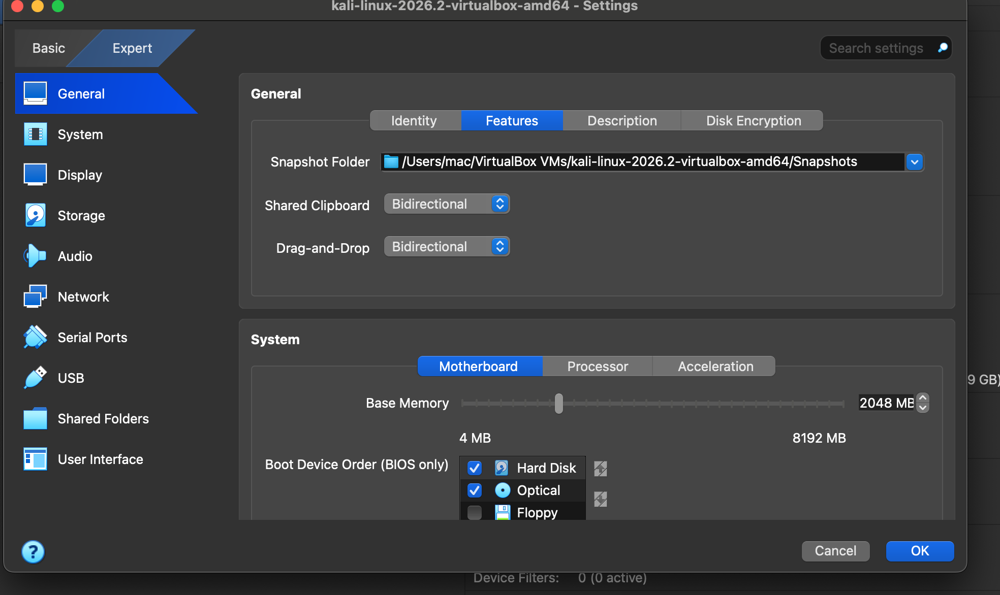
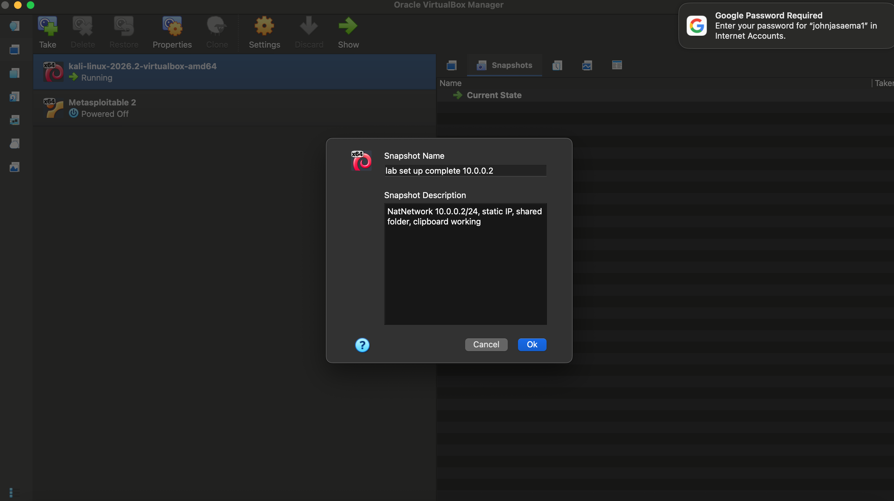

Cybersecurity Lab Setup: Kali Linux + VirtualBox NAT Network

A cybersecurity testing lab built on a MacBook using VirtualBox, with Kali Linux as the attacking machine on an isolated NAT Network.

 Objectives

•⁠  ⁠Use VirtualBox as the virtualization base
•⁠  ⁠Set up Kali Linux as the attacker machine
•⁠  ⁠Create a NAT Network on subnet ⁠ 10.0.0.0/24 ⁠
•⁠  ⁠Enable bidirectional clipboard and drag/drop
•⁠  ⁠Share the host Downloads folder with the VM
•⁠  ⁠Give Kali the static IP ⁠ 10.0.0.2/24 ⁠ with full internet access

Environment

Item     Detail 

 Host | macOS (MacBook Air) 
 Hypervisor | Oracle VirtualBox 
 Guest | Kali Linux 2026.2 (amd64) 
 Network | NatNetwork, ⁠ 10.0.0.0/24 ⁠, DHCP enabled 
 Kali IP |⁠ 10.0.0.2/24 ⁠, gateway ⁠ 10.0.0.1 ⁠ 

 Step 1: Create the NAT Network

In VirtualBox Network Manager, I created ⁠ NatNetwork
Step 3b: Clipboard and drag/drop

Shared Clipboard and Drag'n'Drop are both set to *Bidirectional*.

Step 6: Snapshot

A snapshot of the finished lab was taken as a restore point.

Click Commit changes (top right
